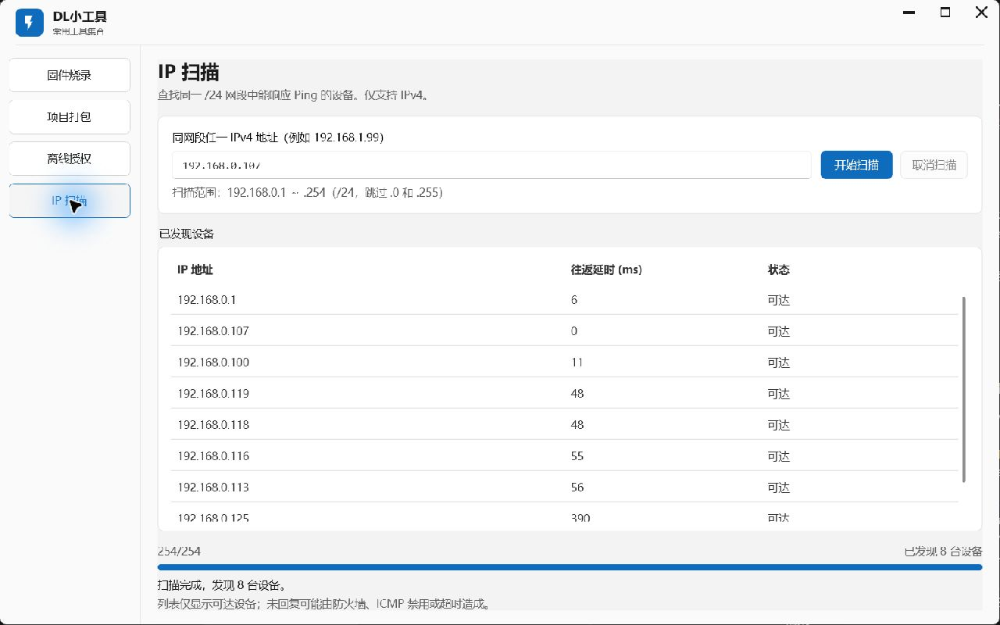

# IP 扫描验收记录

日期：2026-10-19（Asia/Shanghai）。基线 main `10502b2`，功能分支 `codex/ip-scan`。

## 用户验收与合并

2026-10-19，用户反馈“测试发现，符合预期”，授权合并main并删除多余工作树。保留原目录未提交README及图标、教程等文件；测试证据迁至主目录 `tests/DLTools.Tests/TestResults/IP扫描-20261019-合并证据/`。应用归档接口仅返回排队，随后使用 `git worktree remove` 清理本次已合并、干净的工作树；现仅剩主目录，保留功能分支及主干历史。以下人工验收边界保留，不把笼统确认扩大为逐项实测结论。

主目录已从 `10502b2` 快进至 `3cceb2c`，合并后Release构建0警告0错误；普通回归 **173通过、0失败、22跳过**，共195项（本轮未启用2项实网及20项原有打包安装集成测试）。结果为 `tests/DLTools.Tests/TestResults/IPScan-main-postmerge.trx`，不覆盖此前175通过的实网批次。13份原工作树测试证据逐文件SHA-256校验一致；6个原有未跟踪文件哈希一致；README保留原有内容并融合扫描说明，原始字节及可逆融合校验备份见 `.git/codex-safety/ip-scan-merge-20261019/`。

## 实现与接入

- 独立缓存页“IP 扫描”，没有 IP 连接字段，按需求省略双击回填。
- `Services/IpScanService.cs` 纯逻辑枚举 `.1`～`.254`，32 个 SemaphoreSlim 槽位、500ms 超时，使用带 CancellationToken 的 [.NET 8 Ping.SendPingAsync](https://learn.microsoft.com/en-us/dotnet/api/system.net.networkinformation.ping.sendpingasync?view=net-8.0)。串行并等待进度回调；取消或异常后 Task.WhenAll 排空任务再返回。
- `ViewModels/IpScanViewModel.cs` 管理校验、进度、结果和命令；结果增量调度到 UI，取消后抑制排队结果。BackgroundTaskHost 全局互斥，关窗确认取消并等待退出。
- 前三段需匹配在线本机 IPv4 网卡；不支持未指定、回环、组播、保留地址、IPv6、CIDR、自定义掩码。输入 `.0`、`.255` 可以定位网段，但不会探测这两个地址。

## 自动验证

测试结果位于 `tests/DLTools.Tests/TestResults/`（忽略的本地产物，不入 Git）。

| 检查 | 结果与证据 |
|---|---|
| I01 纯服务 | 33/33，`I01-ipscan.trx`；网段、严格 IPv4、32 并发、500ms 参数、超时、预取消、队列取消、异常排空 |
| I02 服务/VM/任务宿主 | 42/42，`I02-ipscan.trx`；UI线程、增量、互斥、保留旧结果、取消等待、重扫、空提示、异常恢复、全局关窗取消入口 |
| I03 补充服务 | 回调异常排空、回调等待期间取消并抑制排队回调；补充取消早于 UI 队列执行时无迟到结果 |
| 实网专项 | 初轮44/44，`I03-ipscan-live.trx`（后续最终全套包含全部新增测试） |
| 最终 Release 构建 | 0 警告、0 错误，`dotnet build "DL小工具.sln" -c Release --no-restore` |
| 最终完整测试（含实网开关） | **175通过、0失败、20跳过**，共195项，`I03-reviewed-full.trx`；20项为未启用的既有打包/安装集成测试 |

开发中一次构建因本次测试窗口占用 EXE（MSB3027/MSB3021）失败，关闭测试窗口后重新构建成功。一次实网证据序列化错误（IPv4 IPAddress.ScopeId 不支持访问）仅发生在测试记录代码，已改为输出字符串地址；失败 TRX 保留为 `I03-ipscan-evidence-serialization-failed.trx`，修复后专项测试通过。

## 真实局域网验证

本机 Windows x64，.NET SDK 9.0.311，目标 net8.0-windows；在线 Intel Wi-Fi 6E AX211，地址 `192.168.0.107`。另有在线以太网 `192.168.1.99`；未修改网卡、路由或防火墙配置。

1. Release GUI 真实扫描 WLAN `/24`，由 `1/254` 增量显示到 `254/254`，发现 **8 台**；例如 `.1` 6ms、`.107` 0ms、`.100` 11ms、`.119` 48ms、`.118` 48ms、`.116` 55ms、`.113` 56ms、`.125` 390ms。列表显示“可达”，含本机回复。
2. 独立调用生产服务完成 `.1`～`.254` 共254次探测，初轮3633ms发现9台；审查修正测试后最终全套轮次 **3708ms、12 台**。完整逐地址状态/延时见 `I03-real-lan.json`（最终轮次）；设备回复与无线延时随轮次变化，数量不要求恒定。
3. 初轮采用150ms定时取消，480ms到终态；审查指出极快网段可能先完成而误报测试失败，因此改为**第一次真实进度回调中请求取消**。最终轮次8ms请求，**491ms**到终态；终态进度回调1次，额外等待600ms仍为1次。见 `I03-real-cancel.json`（最终轮次），前一轮定时取消证据另存 `I03-before-review-cancel.json`。这是实际 .NET Ping 取消验证，不是替代探测函数。

## 界面检查

- 初始空输入与 `192.168.1.999`：立即显示 IPv4 /24 提示，开始扫描禁用；改为合法 IPv4 后立即启用。
- 扫描时输入和开始按钮禁用、取消按钮可用，列表实时追加回复，进度递增。完成后按钮恢复。
- 扫描中切到“项目打包”，其操作控件因全局任务互斥禁用；返回保留扫描输入、已发现列表及完成状态。
- GUI 取消按钮的手动检查轮次在点击前扫描已完成，该次不计作 UI 取消通过；真实取消由生产服务专项和VM测试验证。
- 默认1280×800布局已检查；结果区独立滚动，底部进度与状态可见。未改变系统缩放；150% DPI、最小窗口及所有网卡离线的真实界面情形尚未实测。
- 未在本轮操作忙碌关窗确认的“是/否”真实对话框；代码路径与全局取消/等待由源码审查和VM测试覆盖。未断开用户网络做离线实测。

## 评审与边界

I01、I02各第1轮独立审查通过；I03第2轮新Reviewer通过；最终三名全新Reviewer（需求、架构、风险测试）第1轮全部通过，无阻塞。详情见 `评审记录-IP扫描.md` 与根功能日志。

本次不重跑既有打包安装集成流程、不接 J-Link 硬件、不安装或覆盖现有应用；全量普通测试中对应集成测试按既有开关跳过。网卡无匹配、离线/权限报错不等于空结果；ICMP无响应只代表本轮未发现，不能保证设备不存在。旧的硬件、干净目标机和DPI验收仍保留原记录边界。
